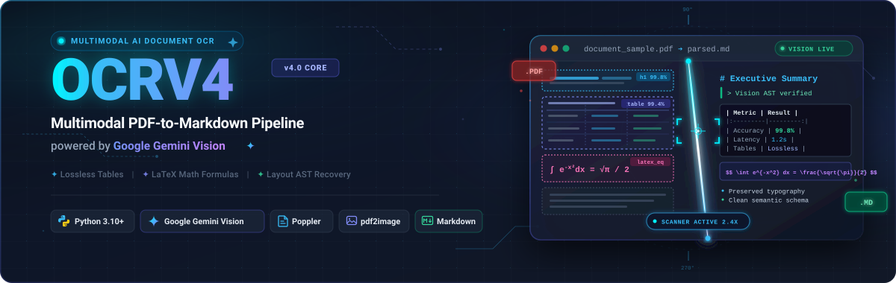
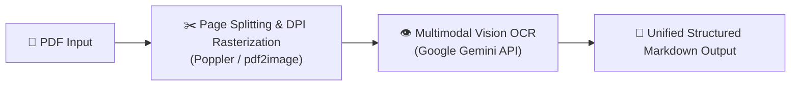

# OCRV4 — Multimodal PDF to Markdown Engine

<p align="left">
  <a href="https://python.org"></a>
  <a href="https://ai.google.dev/"></a>
  <a href="https://poppler.freedesktop.org/"></a>
  <a href="LICENSE"></a>
  <a href="CONTRIBUTING.md"></a>
</p>

OCRV4 is a high-precision CLI pipeline that converts complex PDF documents into structured Markdown using Google Gemini multimodal vision. It delivers pristine layout and content preservation for academic papers, scanned textbooks, and technical documentation. By fusing local Poppler rasterization with state-of-the-art vision models, OCRV4 eliminates traditional OCR inaccuracies.

---

## Architecture



---

## Key Features

- **Multimodal AI OCR**: Direct visual recognition using Google Gemini vision models without brittle heuristics.
- **High-Fidelity Extraction**: Faithfully preserves complex headings, tables, mathematical notation, and nested lists.
- **Auto-Splitting & DPI Scaling**: Configurable resolution (default 300 DPI) with resilient sequential processing.
- **Zero Data Retention**: Temporary page rasters and intermediate files are automatically purged after extraction.

---

## System Prerequisites

OCRV4 requires **Poppler** for high-fidelity PDF rendering and page rasterization:

### macOS (via Homebrew)
```bash
brew install poppler
```

### Linux (Debian / Ubuntu)
```bash
sudo apt-get update && sudo apt-get install -y poppler-utils
```

### Windows (Scoop or Chocolatey)
```powershell
scoop install poppler
# or using Chocolatey:
choco install poppler
```

---

## Quickstart

### Step 1: Clone & Install Requirements
```bash
git clone https://github.com/armandosilva/ocrv4.git
cd ocrv4
pip install -r requirements.txt
```

### Step 2: Set Environment Variables
```bash
cp .env.example .env
# Edit .env and supply your Gemini API credential:
# GEMINI_API_KEY=your_google_gemini_api_key_here
```

### Step 3: Run the Conversion Pipeline
```bash
python pdf_to_markdown_seq.py --pdf document.pdf
```

---

## CLI Options

| Flag | Type | Default | Description |
| :--- | :--- | :--- | :--- |
| `--pdf` | `string` | *(Required)* | Target PDF filename (in `--input-dir`) or direct filesystem path. |
| `--input-dir` | `string` | `input` | Directory containing source PDF documents. |
| `--output-dir` | `string` | `output` | Destination directory where generated Markdown is saved. |
| `--dpi` | `int` | `300` | Rasterization resolution in dots per inch for page images. |
| `--model` | `string` | `gemini-1.5-flash` | Google Gemini multimodal vision model variant (or via `GEMINI_MODEL`). |

---

## License

[](LICENSE)

This project is licensed under the [MIT License](LICENSE) © 2026 Armando Silva.
